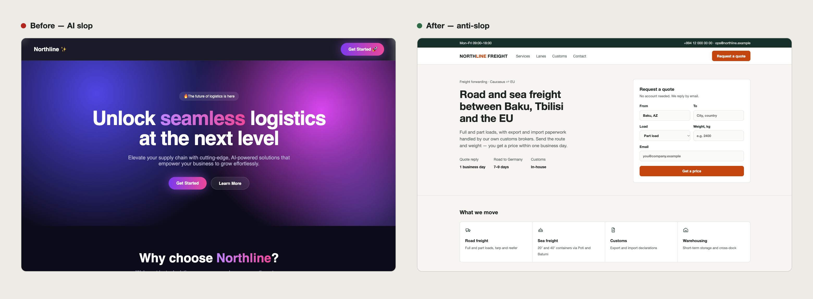
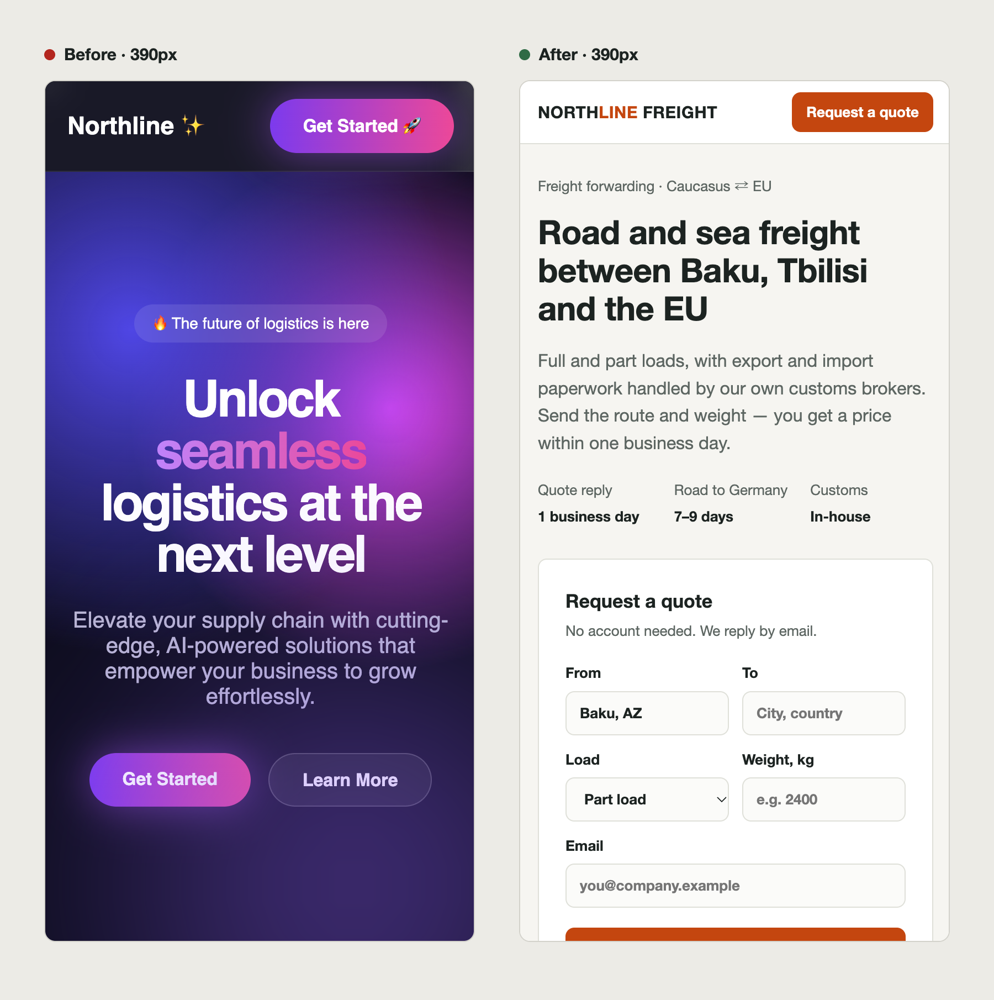
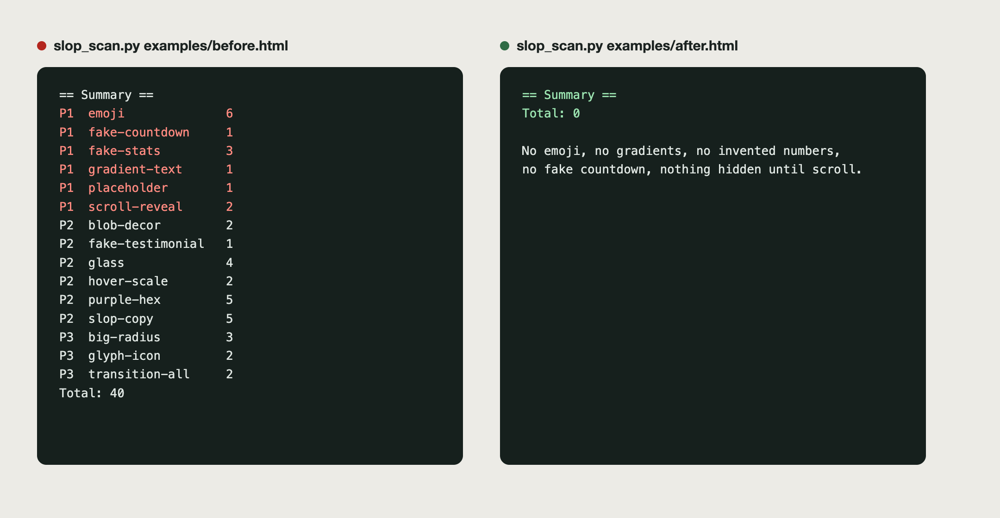

# anti-slop-skills

Three [Claude Code](https://claude.com/claude-code) skills that stop AI-generated interfaces from looking AI-generated — and clean up the ones that already do.

[Azərbaycanca ↓](#azərbaycanca)



| Skill | Use it when | What it does |
|---|---|---|
| **anti-slop-design** | Designing or redesigning a site, app, admin panel, landing page or brochure | Five questions before code, a token-first visual system, layout rules per product type, honest content, mandatory browser verification at 1440/1280/390px |
| **deslop-ui** | An existing UI looks generic, cluttered or "AI-made" | Scanner + visual review + measured checks → prioritised P1/P2/P3 report → fix recipes → re-verify |
| **deslop-copy** | Copy sounds like a press release written by a robot (EN / AZ / RU) | Replaces adjectives with facts, deletes what can't be backed up, sets microcopy rules |

These rules were not invented in a vacuum. They come from client and owner feedback on real production work — an electronics storefront and its admin, an internal product-data tool, a logistics company site, an education agency site — with names removed. See [field notes](skills/anti-slop-design/references/field-notes.md).

## What counts as slop

Purple-to-pink gradients · gradient text · emoji as icons · glassmorphism on every card · `rounded-3xl` + `shadow-2xl` everywhere · centred hero → three icon cards → "10K+ customers" → testimonial carousel · invented statistics · countdowns that restart for every visitor · sections hidden until you scroll · seven different border radii on one page · "Unlock seamless next-level experiences".

Full list: [slop-catalog.md](skills/deslop-ui/references/slop-catalog.md).

## Before and after

Both pages are for the same fictional company, Northline Freight, and both are in [`examples/`](examples) — open them in a browser.

**[Before](examples/before.html)** — what an AI produces when nobody pushes back: a dark purple gradient, a blurred blob, an emoji in the logo and every button, a headline that says nothing ("Unlock seamless logistics at the next level"), three icon cards, invented "10K+ / 99.9%" numbers, a testimonial from John Doe of Acme Corp and a countdown that restarts for every visitor.

**[After](examples/after.html)** — the same company after the three skills: a headline that states what the company does and where, three verifiable facts, the primary action (a quote form) on the first screen, services as a plain list with line icons, a transit-time table instead of made-up stats, one accent colour, one radius, no motion beyond hover colour.

On a phone the difference is bigger. Before, the first screen is all gradient and slogan. After, it is what the company does, how fast it replies and the form to ask for a price:

<p align="center"></p>

## Install

**As a plugin (recommended):**
```
/plugin marketplace add samigiman/anti-slop-skills
/plugin install anti-slop-skills@anti-slop-skills
```

**Or copy the skills:**
```bash
git clone https://github.com/samigiman/anti-slop-skills.git
cp -R anti-slop-skills/skills/* ~/.claude/skills/
```

Then just ask: *"redesign the checkout page"*, *"audit this site for AI slop, don't change anything yet"*, *"this hero copy sounds fake — fix it"*. Claude picks the right skill from the description.

## The scanner

`deslop-ui` ships a dependency-free Python scanner you can run on its own or in CI:

```bash
python3 skills/deslop-ui/scripts/slop_scan.py ./src
python3 skills/deslop-ui/scripts/slop_scan.py ./src --min P2 --json
python3 skills/deslop-ui/scripts/slop_scan.py ./src --fail-on P1   # exit 1 for CI
```

Try it on the bundled examples:

```bash
python3 skills/deslop-ui/scripts/slop_scan.py examples/before.html   # 40 findings
python3 skills/deslop-ui/scripts/slop_scan.py examples/after.html    # 0
```



It is honest about its limits: it finds code-level tells (gradients, emoji, fake stats, scroll-reveal, fake countdowns, clichés). Layout-level slop — no product on the first mobile screen, an unclear primary action — needs the visual review step, which the skill makes mandatory.

## Principles in one screen

1. Decide for *this* product and *this* user, never by default.
2. Tokens before components: one brand colour as a signal, tinted neutrals, one radius, one shadow, a 4–5 step type scale, one line-icon set.
3. Every section earns its place with real content. No real fact → no section.
4. One screen, one obvious next action.
5. No invented numbers, testimonials, logos or urgency.
6. Look at it in a real browser at 1440 and 390px before calling it done — and say what you didn't verify.

## Contributing

Issues and PRs welcome — especially new slop patterns (with a before/after), scanner false positives, and copy-cliché lists for more languages. Keep rules concrete and backed by a real case.

## License

[MIT](LICENSE)

---

## Azərbaycanca

AI ilə yaradılmış interfeysin "AI yığıb" kimi görünməməsi və belə görünənlərin təmizlənməsi üçün üç Claude Code skill-i.

- **anti-slop-design** — yeni dizayn və ya redesign: koddan əvvəl 5 sual, token sistemi, məhsul növünə görə layout qaydaları, dürüst məzmun, brauzerdə məcburi yoxlama.
- **deslop-ui** — mövcud saytı audit edir: skan skripti, vizual baxış, ölçmələr, P1/P2/P3 hesabatı, düzəliş reseptləri.
- **deslop-copy** — mətndən AI klişelərini təmizləyir (AZ / EN / RU): sifət yerinə fakt, sübutsuz iddianı silmək.

Qaydalar real layihələrdəki müştəri rəylərindən çıxarılıb (adlar gizlədilib).

Quraşdırma:
```bash
git clone https://github.com/samigiman/anti-slop-skills.git
cp -R anti-slop-skills/skills/* ~/.claude/skills/
```

Nümunələr: [`examples/before.html`](examples/before.html) (AI slop, skan 40 problem tapır) və [`examples/after.html`](examples/after.html) (təmizlənmiş, 0 problem). Eyni uydurma şirkətin iki versiyasıdır.

Sonra sadəcə yazın: *"bu saytı AI slop üçün audit et, hələ heç nəyi dəyişmə"*.
